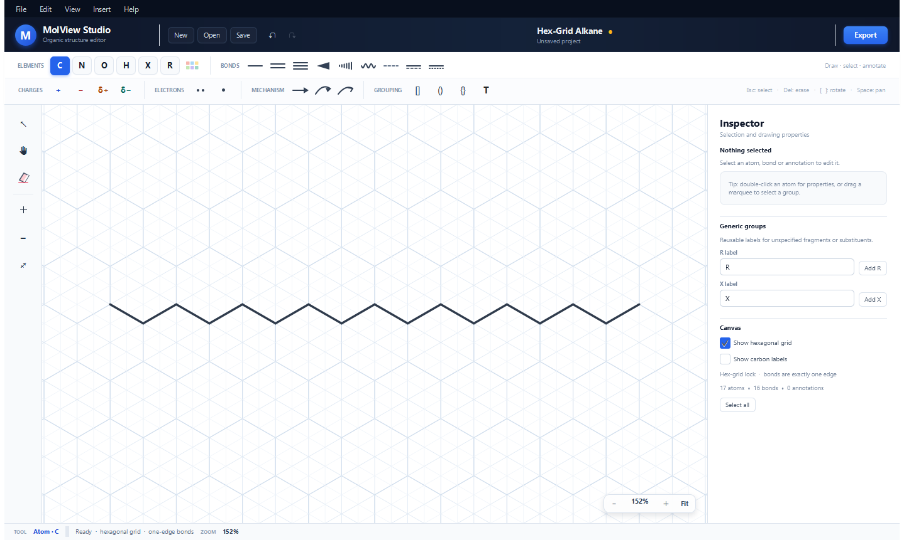
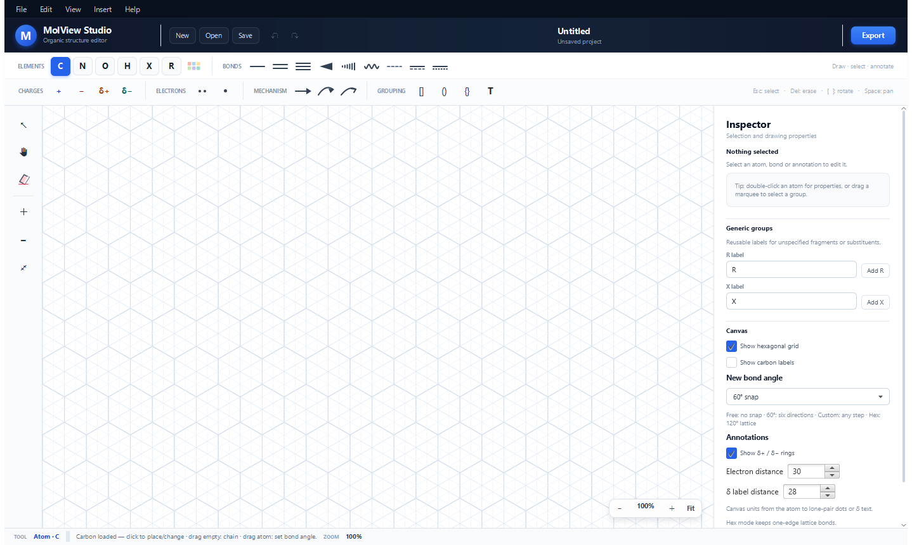
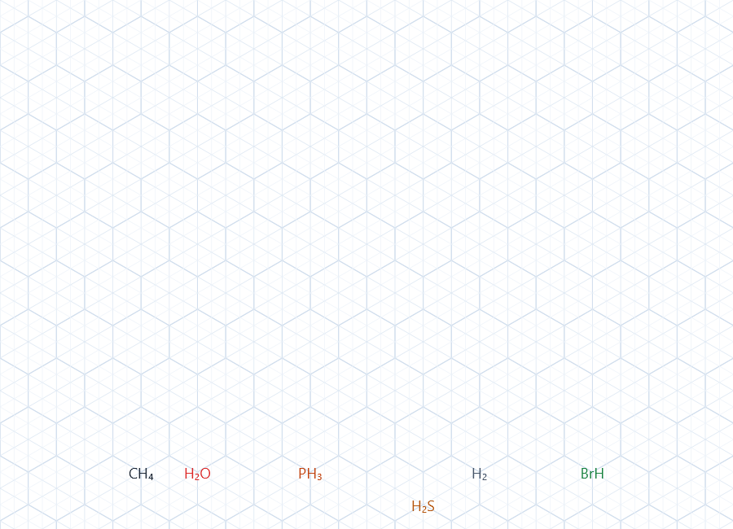
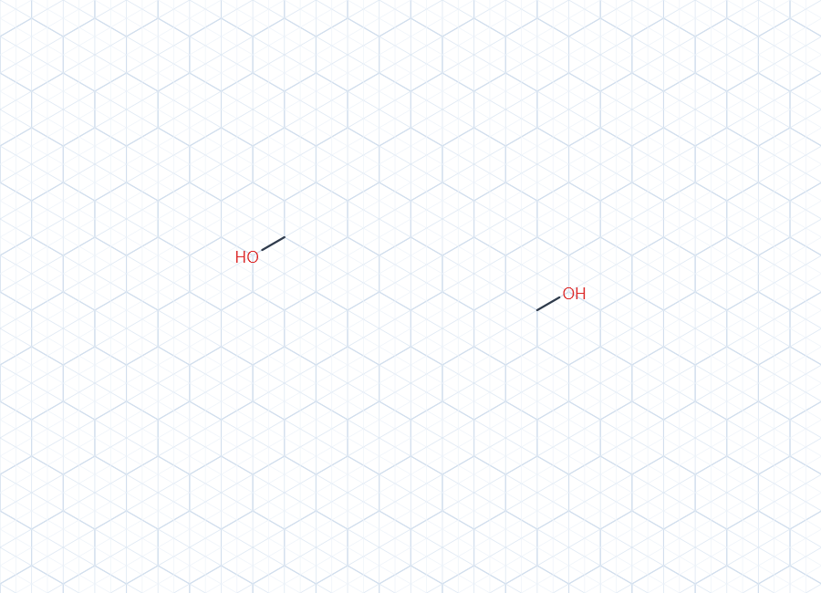
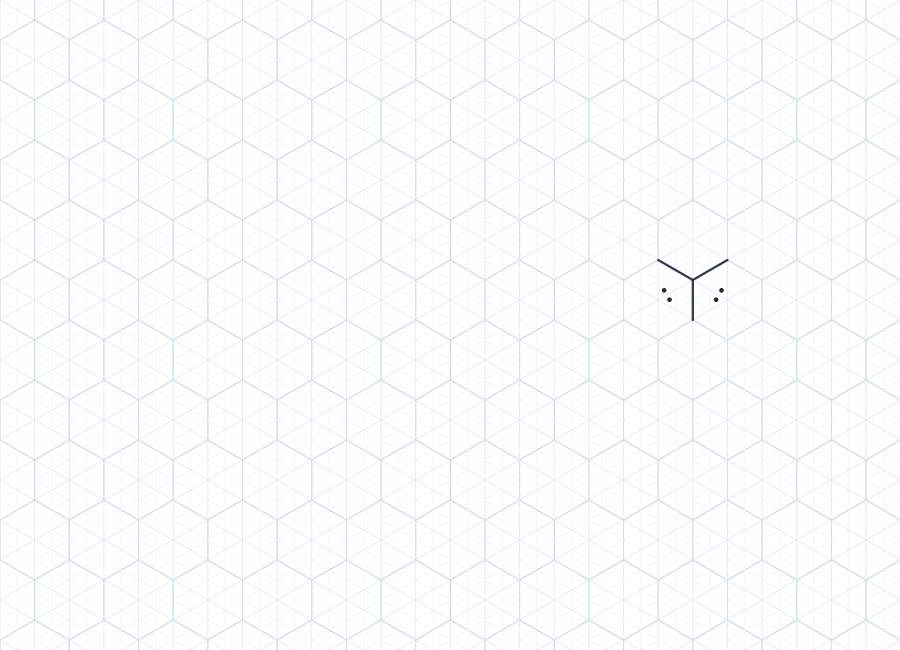
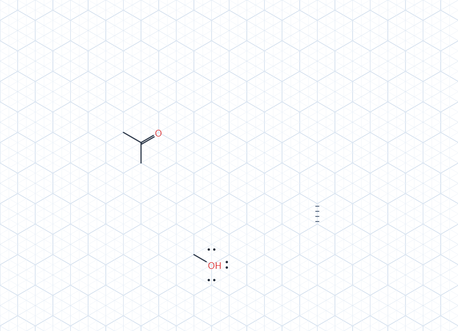
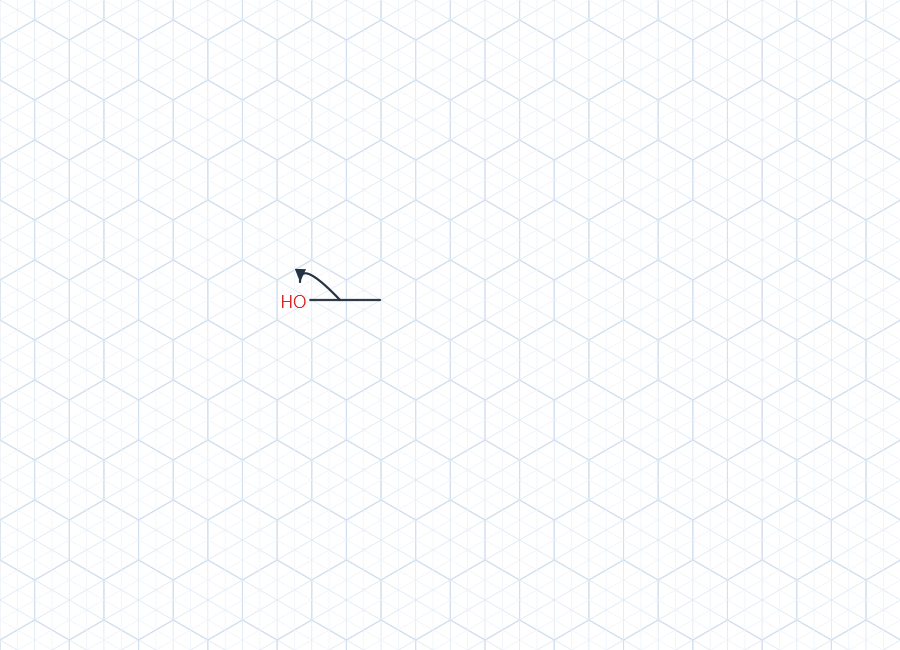
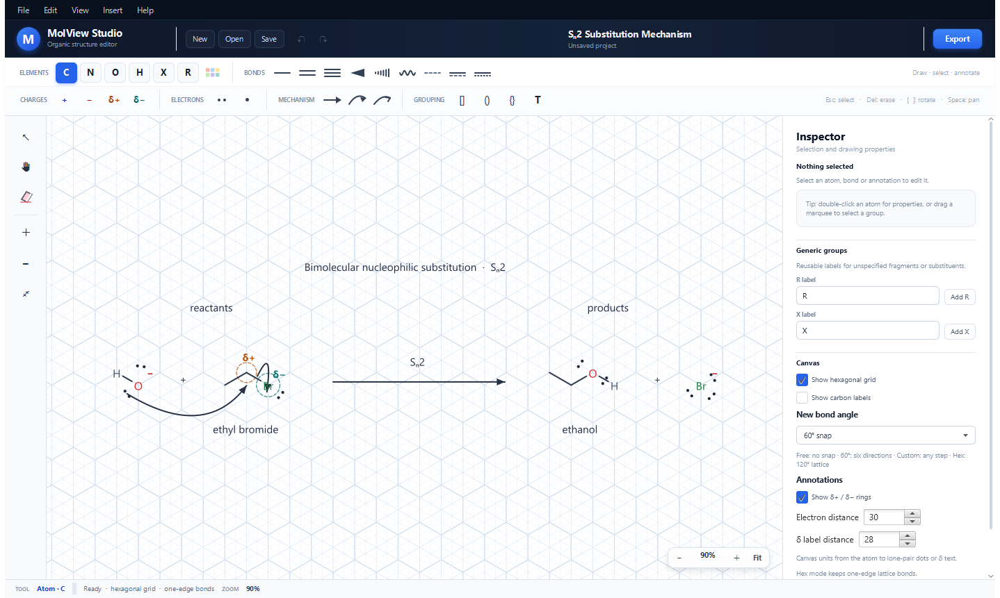

# MolView Studio

A JavaFX organic-chemistry structure editor inspired by MolView. It focuses on
chemical sketching: organic molecules, stereochemical bonds, formal and partial
charges, electron annotations, reaction mechanisms, grouping brackets and
publication-ready export.



Carbon is active as soon as the editor opens. Click a honeycomb vertex to place
one atom, or drag to grow a carbon skeleton. New single bonds use the selectable
**60° snap** mode by default; free, custom-step and strict hex-grid modes are in
the Inspector.

## Highlights

- **Honeycomb sketching** — a pointy-top hexagonal grid with atom snapping and
  optional strict one-edge lattice bonds; new single bonds use the selected
  60°/free/custom/hex angle mode.
- **Alkane chain drawing** — carbon is loaded at startup; dragging on empty space
  starts the chain with that element and fills the remaining vertices with carbon.
- **Elements & generic groups** — quick C/N/O/H palette, all 118 elements in a
  searchable periodic table, and reusable R/X groups with custom labels. Isolated
  atoms use formula labels with implicit hydrogens: `CH₄`, `H₂O`, `PH₃`, `H₂S`,
  `BrH`, `H₂`, and so on.
- **Bonds** — single, double, triple, solid wedge, hashed wedge, wavy, hydrogen,
  aromatic and delocalised/resonance bonds. Newly placed bonds are left
  unselected. Double bonds keep their secondary line clear of a lone connecting
  single bond; a ketone `C=O` joins both double lines to two single bonds on the
  carbonyl carbon. Hydrogen bonds are drawn with horizontal dash strokes.
- **New bond angles** — choose **60° snap**, **Free**, a **Custom** angle step,
  or **Hex grid (120°)** from the Inspector. The setting controls new single
  bonds from the Atom and Bond tools.
- **Charges** — independently selectable `+`, `−`, `δ+` and `δ−` annotations that
  can be positioned around any atom.
- **Electrons** — lone pairs are placed around an atom in a bond-aware order
  (right/top/bottom/left for a left-hand bond, mirrored for a right-hand bond);
  single radical electrons remain independently selectable and movable.
- **Reaction mechanisms** — straight reaction arrows, curved electron-pair
  arrows and single-electron fishhook arrows with draggable endpoints, curve
  handles and atom/bond snapping.
- **Grouping** — square, round and curly brackets with resizable frames and
  optional labels (`n`, charges, etc.).
- **Editing** — selection, marquee selection, move, delete, copy/paste,
  duplicate, rotation, zoom/pan and full undo/redo. In **Select** mode,
  right-click opens Copy/Cut/Paste/Duplicate/Delete for the selection; with any
  drawing tool active, right-click immediately deletes the picked atom or bond.
- **Exports** — PNG (transparent or solid), JPEG, SVG vector, print-ready PDF,
  MOL, SDF and SMILES, with a live preview and selection-only scope.
- **Native projects** — `.molview` JSON projects store every object, label and
  its position, plus canvas view settings, and reopen as fully editable drawings.

## Requirements

- Java 21 (`java` and `javac` on `PATH`)
- Windows for the bundled JavaFX 21 runtime jars. The source code is portable to
  other platforms by replacing the jars in `lib/` with the matching OpenJFX 21
  SDK or by resolving JavaFX through your IDE.

## Run

Double-click `run.bat` or execute:

```bat
cd /d D:\IdealProject\MolView
run.bat
```

`run.bat` rebuilds the project on every launch, so source edits are always picked
up. To build without launching:

```bat
build.bat
```

The built application jar is `build/MolViewStudio.jar`. JavaFX is not shaded into
the jar; it is loaded from `lib/`:

```bat
java -Djavafx.cachedir=build\javafx-cache --module-path lib ^
     --add-modules javafx.controls -cp build/classes com.molview.app.MolViewApp
```

To open the built-in example from the command line:

```bat
run.bat --example
```

## Quick start

1. **Carbon is already active** when the editor opens.
2. **Click** a hex-grid vertex to place one carbon atom. **Drag** across the
   grid to sketch an alkane chain.
3. To start a chain with another element, choose it from the C/N/O/H palette,
   the periodic table, or an R/X group, then drag on empty grid space. The first
   atom uses that element; the rest of the chain is carbon.
4. With an element active, **clicking** an existing atom replaces that atom with
   the selected element. Dragging from an atom creates a new bond using the
   **New bond angle** setting in the Inspector: **60°**, **Free**, **Custom**
   step, or **Hex grid (120°)**. The 60° mode is the default. In Hex mode a long
   carbon drag expands into an alkane chain; empty-space drags still build the
   hex alkane skeleton in every mode.
5. Use the bond tools for single/double/triple/wedge/hydrogen/aromatic bonds.
   In **Hex grid** mode bonds span one adjacent pair of hex vertices; free, 60°
   and custom modes place a standard-length bond at the chosen angle. With the
   single-bond tool active, clicking a single bond cycles it single → triple →
   single.
6. Use the charge, electron and mechanism tools to annotate the structure.
7. Select objects with the Select tool. Shift-click or drag a marquee for
   multiple objects. Drag a selected object to move it. Right-click the selection
   for copy/cut/paste/duplicate/delete; with a drawing tool active, right-click
   deletes the atom or bond under the pointer.
8. Export with **File → Export…** (`Ctrl+E`) or save an editable project with
   **File → Save** (`Ctrl+S`).

The canvas opens directly in Carbon sketch mode; there is no startup dialog.



Placed atoms show their hydrogen-saturated formula until bonds consume the
available valence. `CH₄` becomes `CH₃`, `CH₂`, `CH`, then `C`; `H₂O` becomes `OH`
then `O`; `BrH` becomes `Br`, and likewise for `PH₃`, `H₂S` and `H₂`. Heteroatom
formulas are always visible; carbon formulas follow **Show carbon labels** once
the atom has a bond (an isolated carbon always shows `CH₄`).



Bond-side labels keep the element next to the connection and put implicit H on
the opposite side (`HO—` on the right, `—OH` on the left).



## New bond angle

Open **Inspector → New bond angle**:

- **60° snap** — default; new bonds take one of six 60° directions.
- **Free** — full 360° rotation with no snapping.
- **Custom** — choose any step from 5° to 180°; bonds snap to its multiples.
- **Hex grid (120°)** — restore one-edge hexagonal bonds; long carbon drags can
  again expand into an alkane chain.

The setting applies to new single bonds from the Atom and Bond tools. Empty-space
alkane-chain drags still follow the hexagonal skeleton.

## Annotation distances

The Inspector's **Annotations** controls customize the non-bond marks:

- **Show δ+ / δ− rings** — toggles the coloured rings around partial-charge atoms.
- **Electron distance** — distance from the atom to lone-pair/radical dots (and
  three-bond gap placements); existing electron marks reflow immediately.
- **δ label distance** — distance from the atom to `δ+`/`δ−` text; existing
  partial-charge labels reflow immediately.

Distances are in canvas units (16–80).

## Honeycomb sketching model

- The canvas uses a **pointy-top hexagonal lattice**. Its edge is the editor's
  grid unit (`HexGrid.EDGE`). New atoms are placed on lattice vertices. In
  **Hex grid** mode bonds span exactly one lattice edge; the free/60°/custom
  angle modes place standard-length off-grid endpoints.
- Each hexagon is divided into **six equilateral triangles**, and every one of
  those is subdivided into **four equal triangles** by joining its side
  midpoints.
- The grid is drawn in the same world transform as the molecule, so zooming and
  panning scale the honeycomb together with the skeletal structure.
- A horizontal alkane chain alternates +30° and −30° bonds, producing the normal
  120° skeletal zig-zag.
- Dragging on empty grid space shows a **solid skeletal preview**. The second
  atom is numbered **2**, then 3, 4, … (the first atom is the starting element);
  no completion dialog is shown.
- Dragging from an existing atom draws one new bond at the selected **New bond
  angle**. In **Hex grid** mode a long carbon drag (over 1.5 grid units) expands
  into an alkane chain; free, 60° and custom modes keep it a single
  standard-length bond.
- The previews deliberately show no selected-element ghost or circular atom
  halos.
- **Newly placed bonds start unselected**, leaving the canvas in a clean drawing
  state.
- Rotating a selected horizontal chain performs a lattice-preserving half-turn
  (all rotate commands act end-to-end), so the chain stays horizontal and remains
  exactly on the hexagonal grid.
- Charge and `δ+`/`δ−` labels are automatically placed in a clear sector around
  their atom, avoiding bond strokes and other charge/electron annotations. Delta
  assignments additionally get a coloured ring around the host atom.
- **Lone pairs** are distributed around their host in the order
  **right → top → bottom → left** when the adjacent bond is on the left, and
  **left → top → bottom → right** when it is on the right. Pairs on the left or
  right are drawn vertically so they nestle against the atom. Two-sided or
  vertical bonding falls back to the free faces. Once an atom has **three
  bonds**, lone pairs move into the angular gaps between adjacent bond lines and
  the pair dots are drawn tangentially so they nestle into those gaps.





- A **double bond** is drawn as a centre line plus one secondary line. Away from
  ketones, the secondary line stops short of any connecting single bond, so only
  the centre line touches it. At a ketone `C=O` whose carbonyl carbon carries two
  single bonds, both double-bond lines are joined to the carbonyl carbon and
  therefore touch both single bonds.
- A **hydrogen bond** is drawn as a series of short horizontal dashes along the
  connection.
- **Electron-transfer arrows** snap their endpoints to the middle of a bond and
  stop just outside an atom's element label, so the arrowhead touches neither the
  atom glyph nor its attached hydrogens. When an arrow starts on a bond and points
  to a nearby atom, its curve climbs over the far end of the bond and then falls
  to the atom.
- **Reaction-path arrows** (straight) snap perfectly horizontal while **Shift** is
  held, both when drawing and when dragging an endpoint.



- In **Hex grid** mode the bond tool completes a one-edge lattice bond by
  click-click or drag; in the other angle modes it places a standard-length bond
  at the selected angle. A single-bond-tool click on a single bond cycles it
  single → triple → single; a different active bond tool applies its type
  directly.
- The atom/chain tool turns an empty-space drag into a shortest one-edge path
  across the honeycomb, previews the chain live, and commits it as a single
  undoable action.
- The grid can be hidden from **View → Show Hexagonal Grid**. Lattice locking is
  active in **Hex grid** mode; the other modes deliberately place bond endpoints
  off-grid.

## Keyboard & mouse reference

| Action | Shortcut |
|---|---|
| Undo / redo | `Ctrl+Z` / `Ctrl+Y` (or `Ctrl+Shift+Z`) |
| Cut / copy / paste / duplicate | `Ctrl+X` / `Ctrl+C` / `Ctrl+V` / `Ctrl+D` |
| Delete selection | `Delete` or `Backspace` |
| Select all | `Ctrl+A` |
| Select connected structure | `Ctrl+Shift+A` |
| Rotate selection | `[` / `]` |
| Nudge selection | Arrow keys (`Shift` = 10 px) |
| Zoom around pointer | Mouse wheel |
| Pan | `Space` + drag, middle-mouse drag, or Pan tool |
| Horizontal straight arrow | Hold `Shift` while drawing or dragging an arrow endpoint |
| Actual size / fit drawing | `Ctrl+0` / `Ctrl+Shift+F` |
| New / open / save / export | `Ctrl+N` / `Ctrl+O` / `Ctrl+S` / `Ctrl+E` |
| Return to Select / cancel | `Esc` |

Brackets, arrows and text labels can also be edited from the Inspector on the
right. Double-click a text label to change its content.

## Export details

| Format | What is exported |
|---|---|
| PNG | Lossless raster at the chosen dimensions; optional transparent background |
| JPEG | Compressed raster at the chosen dimensions with a solid background |
| SVG | True vector output with text, paths, arrows and brackets |
| PDF | Print page at the chosen size, orientation, margins and DPI |
| MOL | MDL V2000 atoms, bonds, bond orders, formal charges, wedge/hash stereo, radicals |
| SDF | One record per connected structure plus metadata (component, counts, groups, partial charges) |
| SMILES | Branches, ring closures, aromatic rings, formal charges, disconnected fragments |

The export dialog offers a live preview, full-drawing or selection-only scope,
automatic extension handling and overwrite confirmation. Default output goes to
`exports/`; custom locations can be selected explicitly.

## Projects

Native project files use the `.molview` extension and the `molview-studio-project`
JSON format. They preserve:

- atom symbols, generic labels and positions;
- every bond and its representation;
- formal/partial charge, lone-pair and radical annotations with positions;
- arrows with their curve control points;
- bracket frames, labels and label positions;
- text labels; and
- zoom, pan and canvas display preferences.

Open `projects/S_N2_Substitution.molview` for a complete editable, grid-aligned
Sₙ2 example. A built-in copy is also available from **File → Open Example**.



## Architecture

```
src/main/java/com/molview/app/
  model/        Chemical object model + HexGrid lattice geometry
  editor/       EditorController: tools, selection, clipboard, undo/redo
  render/       JavaFX scene renderer, honeycomb grid, SVG exporter, handles
  io/           Project JSON, MOL/SDF, SMILES, raster/PDF/SVG export
  ui/           Main window, canvas interactions, inspector, dialogs
  config/       Workspace configuration reader
  MolViewApp.java
src/main/resources/
  styles/       JavaFX CSS theme
  assets/       icon and preview texture
  samples/      reserved for bundled sample resources
src/test/java/  Self-test harness and dialog smoke test
lib/            JavaFX 21 runtime jars
config/         app.properties
projects/       editable native project files
exports/        default export destination
assets/         screenshots and source icon for documentation
```

The chemical model and editor core contain no JavaFX code, which makes them
testable independently and keeps the rendering/file layers replaceable.

## Tests

Run the integration self-tests (hex-grid geometry, carbon-ready startup, alkane
chain expansion and horizontal rotation, implicit hydrogen formulas,
charge-label clearance, lone-pair ordering, model/undo, project round-trip,
MOL/SDF/SMILES and PNG/JPEG/PDF/SVG export):

```bat
test.bat
```

The self-test writes its artifacts to `build/test-output/`.

A second batch runs the gesture tests plus JavaFX dialog/preview smoke tests and
captures screenshots of the periodic table, export dialog and inspector:

```bat
ui-test.bat
```

`CanvasInteractionTest` synthesizes mouse gestures for carbon startup, one-edge
bonds, single → triple → single bond clicking, atom replacement, short/long
carbon dragging, angle modes, free-angle terminal bonds, alkane chain expansion,
selection, dragging, charges, electrons, arrows and brackets. It verifies that
skeleton atoms lie on vertices, Hex-mode grid bonds are one hexagon edge, newly
placed bonds are unselected, and free/60°/custom bonds escape the lattice as
configured. It also renders reference images for the ketone double-bond junction,
horizontal hydrogen-bond dashes, lone-pair ordering and isolated formula labels.
`UiSmokeTest` opens and screenshots the periodic-table and export dialogs and
exports a PDF through the dialog;
`InspectorSmokeTest` renders the context inspector with an atom selected.

## Notes and limitations

- PDF pages are rendered at the selected DPI and embedded to preserve exact
  typography and layout; use 300–600 DPI for print. SVG is fully vector.
- Hydrogen-bond lines are drawing annotations and are intentionally omitted from
  MOL/SDF/SMILES molecular graphs.
- SMILES exports connectivity, bond orders, aromaticity, formal charges and
  components. Wedge/hash stereochemistry is preserved in MOL/SDF; SMILES
  tetrahedral chirality and radical-electron marks are not emitted. Radicals
  are written as `M  RAD` records in MOL/SDF.
- The bundled JavaFX jars are for Windows x64; see `lib/README.md` to target
  another platform.

## Third-party software

OpenJFX 21 (GPL v2 with Classpath Exception) is included in `lib/`. The
application source itself uses only the JDK and JavaFX APIs.
